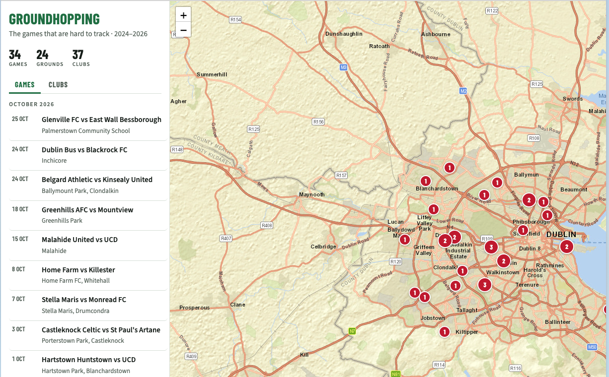

# Groundhopping

A map of the Leinster Senior League football games I go to, plus the odd pre-season friendly and charity match. League of Ireland games already live in [Momento](https://www.acmomento.com/), so this covers the games no app tracks.

**Live:** https://jaslloyd.github.io/groundhopping/ — or open `index.html` locally. No build step, no server.

- **Games** tab: every game, newest first. Click one to fly to the ground.
- **Clubs** tab: every club I've seen, with how many times. Click a club to filter the map to just its grounds and games.
- **Photos:** games with photos show a thumbnail in the list and in the map popup. Tap it to see the photos full size; swipe or use the arrow keys when there's more than one.
- **Share a club:** picking a club puts it in the address bar, e.g. [`?club=Glenville FC`](https://jaslloyd.github.io/groundhopping/?club=Glenville%20FC). Opening that link goes straight to the club's filtered map.

## How the data gets made

The photos I take at games are the source of truth. Each one gets a title (`Home vs Away`), a caption (`Home vs Away – Ground, D Mon YYYY.`) and keywords (`Football` plus both clubs) in Apple Photos, and the photo's GPS gives the ground.

1. [osxphotos](https://github.com/RhetTbull/osxphotos) finds photos taken near pitches and pulls local previews, so nothing has to download from iCloud.
2. I look at a handful at a time and say who was playing; unknown opponents get `[TBC]`.
3. `tools/tag.applescript` writes the title, caption and keywords back to Photos, checking the location is untouched.
4. The tagged photos are grouped by ground into `data/grounds.js`.
5. Wide shots of the game go on the site: `tools/web-photo.swift` makes a 1800px copy in `photos/` and a 480px thumbnail in `photos/thumbs/`, with all metadata removed (no GPS, time or camera details). Each game lists its files under `photos`.

## What's where

| Path | What it is |
|---|---|
| `index.html` | Page structure only |
| `css/styles.css` | All styling, light and dark mode |
| `js/app.js` | Map, games list, clubs tab and club filter |
| `data/grounds.js` | Every ground with the games seen there — add new games here |
| `data/crests.js` | Club name → crest image |
| `crests/` | Crest images |
| `photos/` | Game photos (and `photos/thumbs/`), named `<date>-<home>-<away>-<n>.jpg` |
| `icons/` | Favicon (SVG, with PNG fallbacks for older browsers and iPhone home screens) |
| `tools/tag.applescript` | Writes title, caption and keywords to a photo |
| `tools/web-photo.swift` | Makes a metadata-free web copy of a photo: `swift tools/web-photo.swift in.heic out.jpg [max-size]` |

The data files are `.js` rather than `.json` so the page still works opened straight from disk (browsers block `fetch` on `file://`).

## Credits

- Map tiles © [Esri](https://www.esri.com). Map library: [Leaflet](https://leafletjs.com).
- Club crests belong to their clubs. They come from [Final Whistle](https://www.finalwhistle.ie/soccer/), Wikipedia and club pages; clubs without one get an initials badge.
